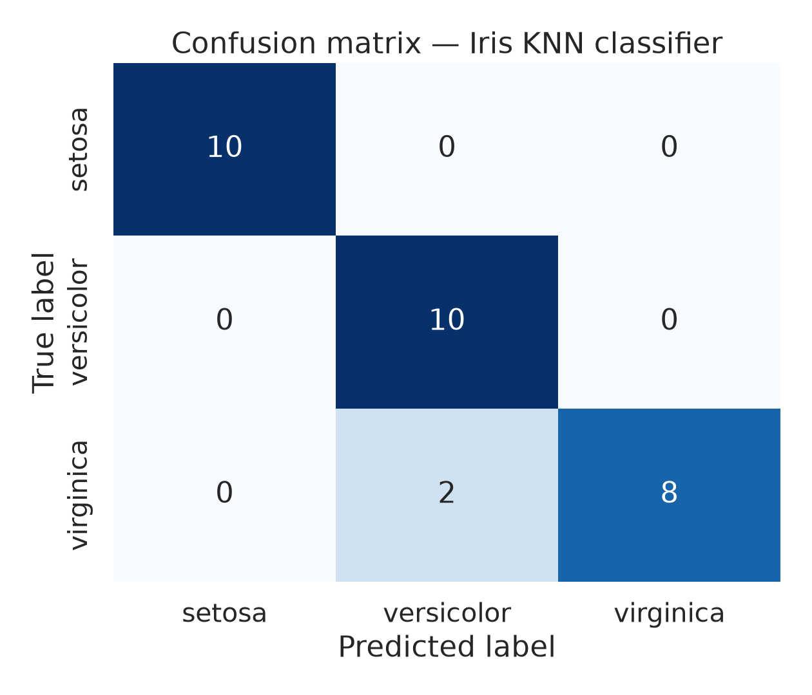
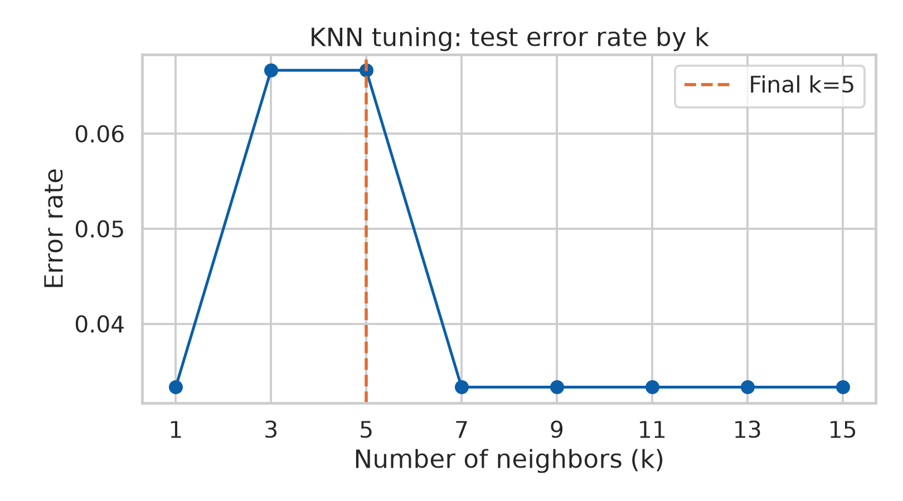
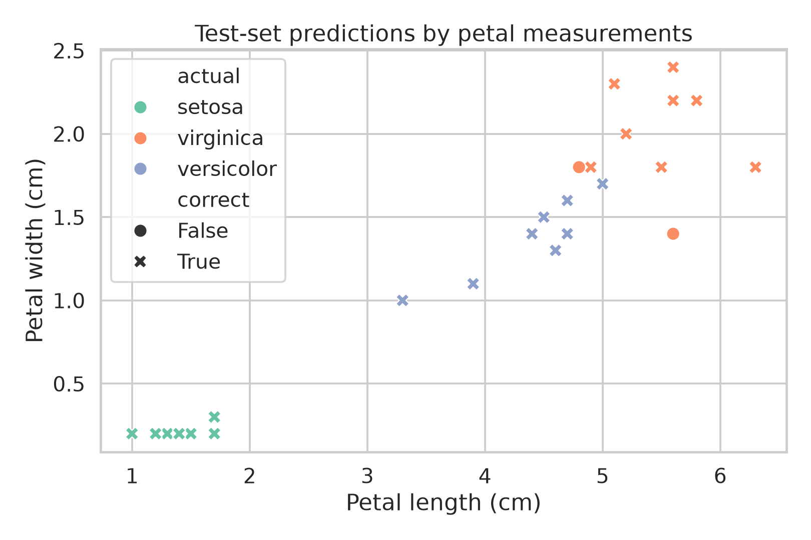

# Iris Flower Classification Using AI


A reproducible supervised-learning project developed for **Project 2 of the DecodeLabs Artificial Intelligence Internship**. The solution classifies Iris flowers into Setosa, Versicolor, or Virginica using a scaled **K-Nearest Neighbors (KNN)** model.

> **Author:** Muhammad Bello Abdussalam  
> **Role:** AI Engineer  
> **Project focus:** Data classification using supervised machine learning

## Project overview

The goal is to demonstrate a complete machine-learning workflow rather than only train a model. The project loads and profiles a labeled dataset, separates training and testing data, applies safe preprocessing, trains a classifier, evaluates performance with multiple metrics, and saves reviewable outputs.

### Objective

Predict the species of an Iris flower from four numerical measurements:

- Sepal length
- Sepal width
- Petal length
- Petal width

### Classes

- **Setosa**
- **Versicolor**
- **Virginica**

## Model architecture

```text
Iris dataset
    |
    v
80/20 stratified train-test split
    |
    v
StandardScaler
    |
    v
K-Nearest Neighbors (k=5)
    |
    v
Predicted Iris species
```

### Why KNN?

KNN is a clear and interpretable distance-based algorithm that is well suited to a small numerical dataset. Feature scaling is included because KNN relies on distances between observations; standardization prevents features with larger numerical ranges from dominating the result.

The implementation also tests odd values of `k` from 1 through 15 to demonstrate how model performance changes as the neighborhood size changes.

## Dataset

The project uses the standard Iris benchmark dataset provided by scikit-learn:

| Property | Value |
|---|---:|
| Samples | 150 |
| Numerical features | 4 |
| Target classes | 3 |
| Samples per class | 50 |
| Missing values | 0 |
| Training samples | 120 |
| Testing samples | 30 |

The dataset is loaded programmatically and exported to `artifacts/iris_dataset.csv` when the pipeline runs.

## Verified performance

The final pipeline uses `StandardScaler` followed by `KNeighborsClassifier(n_neighbors=5)`. Evaluation was performed on the held-out test set using a fixed `random_state=42`.

| Metric | Score |
|---|---:|
| Accuracy | **93.33%** |
| Weighted precision | **94.44%** |
| Weighted recall | **93.33%** |
| Weighted F1 score | **93.27%** |
| Correct predictions | **28 / 30** |

### Class-level results

| Class | Precision | Recall | F1 score |
|---|---:|---:|---:|
| Setosa | 100.00% | 100.00% | 100.00% |
| Versicolor | 83.33% | 100.00% | 90.91% |
| Virginica | 100.00% | 80.00% | 88.89% |

Setosa was classified perfectly. The two incorrect predictions were Virginica samples classified as Versicolor, reflecting the greater measurement overlap between those two classes.

## Visual evidence

### Confusion matrix



### KNN tuning



### Test-set predictions



## Quick start

### 1. Clone the repository

```bash
git clone https://github.com/Belloblaze-web3/ai-classification-internship-project.git
cd ai-classification-internship-project
```

### 2. Create and activate a virtual environment

```bash
python -m venv .venv
source .venv/bin/activate        # Windows: .venv\\Scripts\\activate
```

### 3. Install dependencies

```bash
pip install -r requirements.txt
```

### 4. Run the machine-learning pipeline

```bash
python src/train_model.py
```

The script creates or refreshes all files in the `artifacts/` directory, including metrics, visualizations, predictions, the serialized pipeline, and the dataset profile.

### 5. Generate the internship presentation

```bash
python create_presentation.py
```

This generates the editable `Iris_AI_Classification_Internship_Submission.pptx` presentation.

## Repository structure

```text
.
├── artifacts/
│   ├── confusion_matrix.png
│   ├── dataset_profile.json
│   ├── iris_dataset.csv
│   ├── iris_knn_pipeline.pkl
│   ├── knn_tuning.csv
│   ├── knn_tuning.png
│   ├── metrics.json
│   ├── prediction_scatter.png
│   ├── presentation_preview/
│   └── test_predictions.csv
├── src/
│   └── train_model.py
├── create_presentation.py
├── Iris_AI_Classification_Internship_Submission.pptx
├── REPORT.md
├── requirements.txt
└── README.md
```

## Engineering practices demonstrated

- Reproducible train/test splitting with a fixed random seed
- Stratified sampling to preserve class balance
- Preprocessing integrated into a scikit-learn `Pipeline`
- Hyperparameter experimentation for the KNN neighborhood size
- Evaluation beyond accuracy using precision, recall, F1, and a confusion matrix
- Export of row-level predictions and model artifacts for review
- Clear technical documentation and presentation of results

## Limitations

The Iris dataset is small, clean, and balanced. Its strong performance should not be interpreted as evidence that the model is ready for high-risk production use. A production implementation would require larger representative data, cross-validation, automated data validation, experiment tracking, model versioning, monitoring, drift detection, security controls, and domain-specific review.

One educational simplification in this project is that the `k` exploration is displayed on the held-out test split. In a production workflow, the test set should remain untouched until final evaluation, and model selection should use cross-validation within the training data.

## Future improvements

1. Add cross-validation and automated hyperparameter search.
2. Compare KNN with Logistic Regression, Decision Trees, Random Forest, and SVM models.
3. Add unit tests and data-quality validation checks.
4. Package the model behind a REST API.
5. Add experiment tracking and model versioning.
6. Create a lightweight deployment with monitoring for prediction drift.

## Internship deliverables

- [Technical project report](REPORT.md)
- [Editable internship presentation](Iris_AI_Classification_Internship_Submission.pptx)
- [Python presentation generator](create_presentation.py)
- [Evaluation metrics](artifacts/metrics.json)
- [Saved model pipeline](artifacts/iris_knn_pipeline.pkl)

## License

This project is intended for educational and portfolio use as part of the DecodeLabs Artificial Intelligence Internship.
